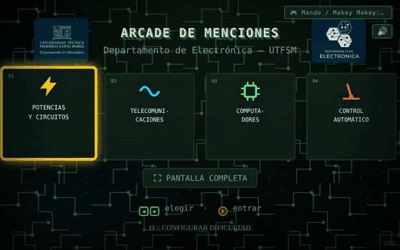
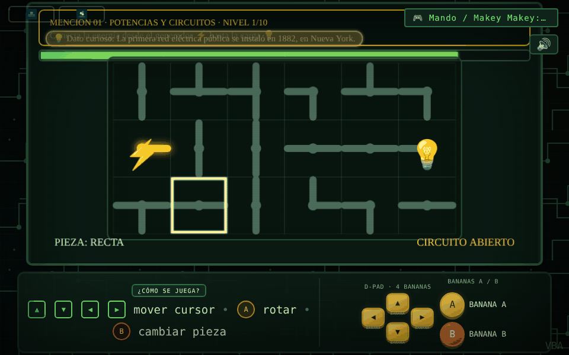

# Arcade de Menciones — Ingeniería Civil Electrónica UTFSM

> **EN:** Educational arcade for UTFSM outreach events: four mini-games, one per specialization of Electronic Engineering, played by touching fruit wired to a Makey Makey. **[Play in the browser](https://vicentebohlealveal.github.io/vicente-bohle-software-portfolio/projects/arcade-menciones/)** (arrow keys to choose, Space or Z to enter, Esc to go back).

Juego educativo web para actividades de divulgación de Ingeniería Civil Electrónica. Integra cuatro minijuegos asociados a áreas de la carrera y una interfaz física con Makey Makey.

## Ejecutar

Abrir `index.html` en un navegador moderno. No requiere instalar dependencias ni compilar. La tipografía se carga desde Google Fonts cuando hay conexión a Internet; el juego está implementado en un único archivo HTML con CSS y JavaScript embebidos.

## Controles

| Tecla | Makey Makey | Acción |
|---|---|---|
| Flechas | D-pad (4 frutas) | Elegir mención, mover o ajustar |
| Espacio o Z | Fruta A | Entrar / acción principal |
| X o clic | Fruta B | Acción secundaria |
| Esc | — | Volver al menú |
| D | — | Configurar dificultad (en el menú) |

## Contenido

- `index.html`: aplicación completa.
- `manual-operador.html`: versión HTML del manual de operador.

## Créditos y condición del manual

El manual del operador fue desarrollado por Vicente Bohle Alveal y vendido a la Universidad Técnica Federico Santa María (UTFSM) para uso institucional. Se incluye aquí como muestra de portafolio con autorización de publicación. Mantener la atribución al autor/desarrollador y la referencia a la venta/entrega institucional. Esta publicación no concede automáticamente derechos de reutilización, modificación o redistribución; deben respetarse los términos acordados con la UTFSM y el autor.

El juego fue preparado para demostraciones educativas. Mantener los créditos ya presentes en el código, incluida la atribución `VBA`.

## Historial de versiones

La rama [`historial`](https://github.com/vicentebohlealveal/arcade-menciones/tree/historial) reconstruye, commit por commit, cómo evolucionó el programa a partir de las versiones que quedaron guardadas. El resumen está en [`VERSIONES.md`](https://github.com/vicentebohlealveal/arcade-menciones/blob/historial/VERSIONES.md).

## Licencia / License

© 2026 Vicente Bohle Alveal. Todos los derechos reservados / All rights reserved. Público solo para revisión como portafolio; ver [LICENSE](LICENSE).

Parte del [portafolio de Vicente Bohle Alveal](https://github.com/vicentebohlealveal/vicente-bohle-software-portfolio).
